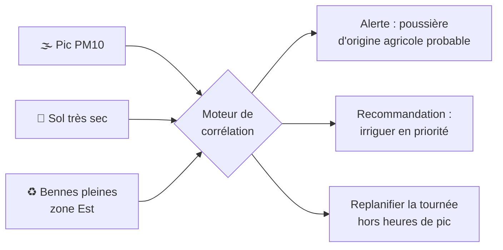
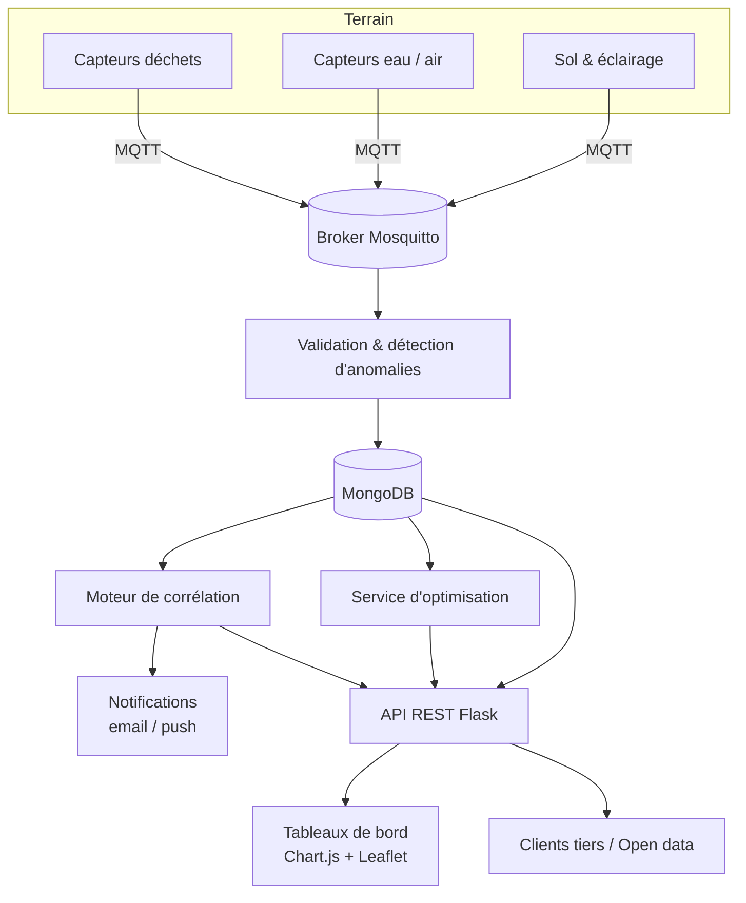
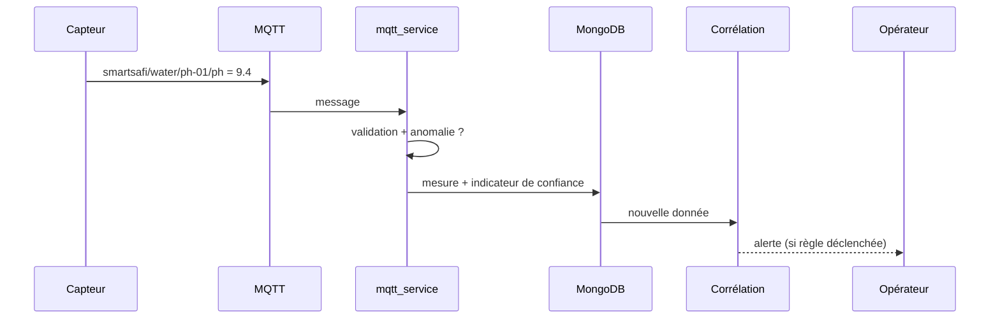

<div align="center">

# 🌊 SmartSafi

### La ville qui se comprend, s'anticipe et s'optimise.

**Plateforme Smart City open source pour Safi (Maroc) : une seule vue sur les déchets, l'eau, l'air, l'agriculture et l'éclairage, avec un moteur qui relie les données entre elles.**

[](https://www.python.org/)
[](https://flask.palletsprojects.com/)
[](https://www.mongodb.com/)
[](https://mqtt.org/)

[](#-contribuer)

[Démarrage en 2 minutes](#-démarrage-en-2-minutes) ·
[Innovation](#-ce-qui-rend-smartsafi-différent) ·
[Architecture](#-architecture) ·
[API](#-api) ·
[Roadmap](#-roadmap)

</div>

---

## 🎯 Le problème

Dans la plupart des villes, chaque service tourne en silo : la collecte des déchets ne parle pas à la qualité de l'air, l'éclairage ignore la fréquentation, l'irrigation ignore la ressource en eau. Résultat : des décisions locales, réactives, et coûteuses.

**SmartSafi part de l'idée inverse :** les données urbaines sont plus utiles *ensemble* que séparées.

| Sans SmartSafi | Avec SmartSafi |
|---|---|
| Tournées de collecte à horaires fixes | Tournées calculées selon le remplissage réel |
| Alertes qualité d'eau après plainte | Détection d'anomalie avant dégradation |
| Lampadaires allumés à pleine puissance | Intensité adaptée au contexte |
| 5 outils, 5 tableaux de bord | 1 plateforme, 1 carte, 1 API |

---

## 🧩 Les 5 modules

| Module | Ce qu'il mesure | Capteurs / données |
|---|---|---|
| ♻️ **Déchets** | Remplissage, statut, position | 4 zones : Nord, Sud, Est, Ouest |
| 💧 **Eau** | Qualité en continu | pH, turbidité, conductivité, température |
| 🌫️ **Air** | Polluants atmosphériques | PM2.5, PM10, O₃, NO₂, SO₂, CO |
| 🌱 **Agriculture** | État du sol | Humidité, température, pH, NPK |
| 💡 **Éclairage** | État et consommation LED | 2 quartiers, gradation à distance |

---

## 💡 Ce qui rend SmartSafi différent

> Cette section décrit la **vision d'ingénierie** du projet. Chaque piste est rattachée à la [roadmap](#-roadmap) avec son niveau de maturité.

### 1. Moteur de corrélation inter-domaines

Le cœur de l'innovation : un moteur de règles qui croise les modules au lieu de les traiter isolément.



Exemples de règles :

- *Air dégradé + éclairage faible → augmenter l'intensité sur les axes concernés.*
- *Bennes > 80 % + pic de pollution → décaler la collecte pour limiter l'exposition des agents.*
- *Turbidité en hausse + humidité du sol élevée → suspicion de ruissellement, notifier l'opérateur eau.*

### 2. Collecte prédictive plutôt que planifiée

Chaque benne apprend son propre rythme de remplissage (jour de semaine, saison, événements). Le service d'optimisation calcule alors **quelles bennes vider, dans quel ordre, avec quel trajet**, plutôt que de faire passer un camion devant des bennes à moitié vides.

### 3. Détection d'anomalies à la source (edge-first)

Les capteurs publient en MQTT ; une première validation (plage physique, dérive, valeur figée) est faite **avant** l'écriture en base. On distingue ainsi une vraie alerte d'un capteur défaillant, ce qui réduit fortement les fausses alarmes.

### 4. Indice de Résilience Urbaine (IRU)

Un score synthétique par zone, calculé à partir des cinq modules, pour comparer des quartiers et suivre l'effet des décisions dans le temps.

```
IRU(zone) = Σ ( poids_module × score_normalisé_module )   →   0 à 100
```

Les poids sont configurables : une commune agricole et une zone portuaire n'ont pas les mêmes priorités.

### 5. Jumeau numérique léger

Rejouer l'historique pour répondre à « que se serait-il passé si… ? » : simuler un changement de fréquence de collecte, une baisse d'intensité d'éclairage, ou une panne de capteurs, **sans toucher à la production**.

### 6. Open data par conception

Toute donnée non sensible est exposée en API ouverte et exportable (CSV/JSON), pour les chercheurs, les étudiants et les associations. La ville devient une plateforme, pas une boîte noire.

---

## 🚀 Démarrage en 2 minutes

### Option A : Docker (recommandé)

```bash
git clone https://github.com/<votre-org>/smartsafi.git
cd smartsafi
cp .env.example .env
docker-compose up -d
```

Ouvrez **http://localhost:5000**.

### Option B : installation locale

```bash
python -m venv venv && source venv/bin/activate     # Windows : venv\Scripts\activate
pip install -r requirements.txt
cp .env.example .env
flask init-db
flask create-admin --username admin --email admin@example.com
python run.py
```

### Vérifier que tout fonctionne

```bash
curl http://localhost:5000/api/v1/waste     # liste des poubelles
pytest -q                                    # suite de tests
```

<details>
<summary><b>Prérequis</b></summary>

- Python 3.8+
- MongoDB 4.0+
- Broker MQTT (Mosquitto) pour les capteurs réels
- Node.js 14+ uniquement pour les outils de build frontend
</details>

---

##  Architecture



### Flux d'une mesure, de bout en bout



### Stack

| Couche | Technologies |
|---|---|
| Backend | Python, Flask, Gunicorn |
| Données | MongoDB, Flask-PyMongo |
| Sécurité | Flask-Login, JWT, Flask-WTF, Flask-Limiter |
| Temps réel | Paho-MQTT, Mosquitto |
| Frontend | Bootstrap 5, Chart.js, Leaflet, jQuery |
| Notifications | Flask-Mail |

### Décisions d'architecture (ADR)

| # | Décision | Pourquoi |
|---|---|---|
| 1 | **MongoDB** plutôt que SQL | Mesures hétérogènes par capteur, schéma évolutif |
| 2 | **MQTT** plutôt que HTTP pour l'IoT | Léger, bas débit, adapté aux capteurs sur batterie |
| 3 | **Application Factory** Flask | Configs dev / prod / test isolées, tests plus simples |
| 4 | **Un blueprint par domaine** | Un module = une équipe possible, ajout sans régression |
| 5 | **API d'abord** | L'interface web n'est qu'un client parmi d'autres |

---

## 🔌 API

Base : `/api/v1` · Documentation interactive : `/api/docs`

```bash
# Lire une poubelle
curl -H "Authorization: Bearer $TOKEN" http://localhost:5000/api/v1/waste/bin_001
```

| Ressource | GET | POST | PUT | DELETE |
|---|:-:|:-:|:-:|:-:|
| `/waste` | ✅ | ✅ | ✅ | ✅ |
| `/water` | ✅ | ✅ | ✅ | ✅ |
| `/air` | ✅ | ✅ | ✅ | ✅ |
| `/agriculture` | ✅ | ✅ | ✅ | ✅ |
| `/lighting` | ✅ | ✅ | ✅ | ✅ |

**Rôles :** `admin` · `operator` · `driver` · `viewer`

### Convention MQTT

```
smartsafi/{domaine}/{id_capteur}/{mesure}
```

```json
{
  "timestamp": "2026-01-15T10:30:00Z",
  "device_id": "bin_001",
  "value": 0.75,
  "unit": "ratio",
  "battery": 85,
  "signal_strength": -65
}
```

<details>
<summary><b>Tous les topics par domaine</b></summary>

| Domaine | Topics |
|---|---|
| Déchets | `fill_level` · `status` · `location` · `command/collect` |
| Eau | `ph` · `turbidity` · `conductivity` · `temperature` |
| Air | `pm25` · `pm10` · `o3` · `no2` · `so2` · `co` |
| Agriculture | `soil_moisture` · `soil_temperature` · `soil_ph` · `npk_n` · `npk_p` · `npk_k` |
| Éclairage | `status` · `intensity` · `energy` · `command/dim` · `command/on` · `command/off` |
</details>

---

## 📁 Structure du projet

```
smartsafi/
├── app/
│   ├── models/        # un modèle par domaine (waste, water, air, ...)
│   ├── routes/        # blueprints : auth, dashboard, api, modules
│   ├── services/      # mqtt, optimisation, notifications
│   ├── utils/         # validators, decorators, data_store
│   ├── templates/     # layouts / partials / pages
│   └── static/        # css, js, img
├── config/            # base, development, production, testing
├── tests/             # auth, api, models, forms, services
├── docs/              # architecture.md, api.md
├── scripts/           # setup, backup
├── run.py             # entrée développement
└── wsgi.py            # entrée production
```

---

## ⚙️ Configuration

| Variable | Rôle | Défaut |
|---|---|---|
| `FLASK_ENV` | Environnement | `development` |
| `SECRET_KEY` | Clé secrète | **obligatoire en prod** |
| `MONGO_URI` | Connexion MongoDB | `mongodb://localhost:27017/smartsafi` |
| `MQTT_BROKER_HOST` / `PORT` | Broker MQTT | `localhost` / `1883` |
| `MAIL_SERVER` / `PORT` | SMTP | `-` / `587` |
| `MAIL_USERNAME` / `PASSWORD` | Identifiants SMTP | `-` |

---

##  Sécurité & confidentialité

- Authentification **JWT + sessions**, mots de passe hachés, rôles à privilèges minimaux.
- **Rate limiting** sur les routes sensibles (connexion, API).
- HTTPS obligatoire en production, `DEBUG` désactivé.
- Secrets uniquement via variables d'environnement, jamais dans le dépôt.
- Les données exposées en open data sont **agrégées et non nominatives**.

---

##  Qualité

```bash
pytest                      # tous les tests
pytest --cov=app tests/     # avec couverture
flake8 && pylint app        # lint
```

Objectif de couverture : **> 80 %**. Style : PEP 8, docstrings Google-style.

---

##  Roadmap

| Horizon | Chantier | Maturité |
|---|---|---|
| **Maintenant** | 5 modules, API REST, MQTT, tableaux de bord, cartes | 🟢 Socle |
| **Court terme** | Validation d'anomalies à l'ingestion | 🟡 À formaliser |
| **Court terme** | Notifications multi-canaux (email, push, SMS) | 🟡 En cours |
| **Moyen terme** | Moteur de corrélation inter-domaines | 🔵 Conception |
| **Moyen terme** | Collecte prédictive (prévision de remplissage) | 🔵 Conception |
| **Moyen terme** | Indice de Résilience Urbaine (IRU) | 🔵 Conception |
| **Long terme** | Jumeau numérique et simulation « what-if » | ⚪ Exploration |
| **Long terme** | Application mobile pour agents de terrain | ⚪ Exploration |
| **Long terme** | Portail open data public | ⚪ Exploration |

> 🟢 disponible · 🟡 en cours · 🔵 conçu · ⚪ idée

---

##  Déploiement

<details>
<summary><b>Docker Compose</b></summary>

```bash
docker-compose up -d
docker-compose logs -f app
docker-compose down
```
</details>

<details>
<summary><b>Serveur classique (Gunicorn + Nginx)</b></summary>

```bash
pip install -r requirements-prod.txt
flask init-db && flask create-admin
gunicorn -w 4 -b 0.0.0.0:8000 wsgi:application
```

```nginx
server {
    listen 80;
    server_name smartsafi.example.com;

    location / {
        proxy_pass http://127.0.0.1:8000;
        proxy_set_header Host $host;
        proxy_set_header X-Real-IP $remote_addr;
        proxy_set_header X-Forwarded-For $proxy_add_x_forwarded_for;
        proxy_set_header X-Forwarded-Proto $scheme;
    }

    location /static {
        alias /path/to/smartsafi/app/static;
        expires 30d;
    }
}
```
</details>

---

##  FAQ

**Faut-il de vrais capteurs pour tester ?**
Non. Les données de démonstration et un publieur MQTT simulé suffisent pour explorer toute la plateforme.

**Peut-on ajouter un nouveau domaine (bruit, trafic...) ?**
Oui : un modèle, un blueprint, des topics MQTT. L'architecture est pensée pour ça.

**Et pour une autre ville que Safi ?**
Les zones et quartiers sont de la configuration, pas du code : le projet est réutilisable.

---

##  Contribuer

1. Forkez le dépôt
2. Créez une branche : `git checkout -b feature/ma-fonctionnalite`
3. Commitez : `git commit -m "feat: ajoute ..."`
4. Poussez et ouvrez une Pull Request

Convention de commits : [Conventional Commits](https://www.conventionalcommits.org/fr/) (`feat`, `fix`, `docs`, `refactor`, `test`).

---

## 📚 Glossaire

| Terme | Définition |
|---|---|
| **MQTT** | Protocole de messagerie léger publication/abonnement pour l'IoT |
| **Edge** | Traitement au plus près du capteur, avant le serveur central |
| **Jumeau numérique** | Réplique virtuelle de la ville pour simuler des scénarios |
| **IRU** | Indice de Résilience Urbaine, score 0-100 par zone |
| **ADR** | Architecture Decision Record, trace d'une décision technique |

---
**Fatima Chegdani**

<p>
  <a href="https://fatima1234-cheg.github.io/portfolio-fatima/">
    
  </a>
  <a href="https://www.linkedin.com/in/fatima-chegdani-44b840274/" target="_blank">
  
</a>
  <a href="https://github.com/fatima1234-cheg">
    
  </a>
</p>

<div align="center">

**SmartSafi : construire la ville intelligente de demain, avec ses habitants.**

⭐ Si le projet vous est utile, laissez une étoile.

</div>
